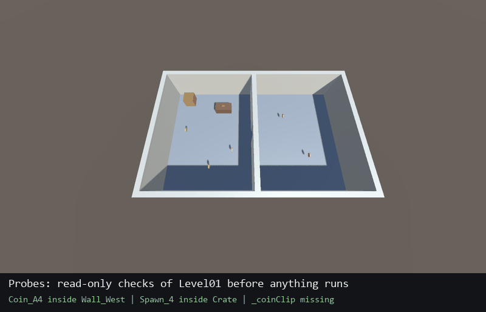

# unity-playtest: Claude can't play your Unity game. Now it can test it.

> **v0.2, private preview.** Tested on one real Unity 6 + Netcode project and on
> [Unity-Playtest-Sample](https://github.com/GhazaGG/Unity-Playtest-Sample), with three evals run with and without the
> skill ([results](#evals)). See [DESIGN.md](DESIGN.md).



Claude can compile your project and run your unit tests, but it can't play your game. The bugs that reach review usually live in scenes, timing, physics and networking.

**unity-playtest** is a Claude Code skill that turns your feature's "How to test" into evidence. It drives the running Unity Editor, and a local development build, through Unity's own Pipeline CLI.

- **Editor probes.** Finds objects stuck in colliders, blocked spawn spots, missing references, and prefabs missing from the network list, and takes Scene view screenshots.
- **Scripted Play Mode.** Plays through your game's real input path: aim at the target, let your interaction detector pick it, then call the same method the key press calls. It checks state and takes Game view screenshots.
- **Host + client.** Runs the Editor as host and a development build as client, with simulated latency, and checks every step on both peers. It also sends intents a real client couldn't send, such as from too far away or through a wall, to prove your server rejects them.
- **Honest report.** A checklist with pass, fail and skip. Each case says whether a script or a human verified it. Feel, sound and visuals are never marked passed by a script.

On its first real project, a Unity 6 + Netcode co-op game, it found three bugs that tests and code review had missed. They are listed in [DESIGN.md](DESIGN.md#proof-it-is-worth-it).
A full example checklist and report from the sample project are in [examples/](examples/).

## Requirements

- Unity 6 with `com.unity.pipeline` (tested 0.9.1-exp.1 and 0.8.0-exp.1; 0.9 renamed the CLI commands, and the skill handles both) and the `unity` CLI
- Claude Code
- For host + client: Netcode for GameObjects 2.x with Unity Transport 2.x (other stacks: adapter notes welcome)
- Tested on Windows

## Install

In Claude Code:

```
/plugin marketplace add GhazaGG/Unity-Playtest-for-Claude
/plugin install unity-playtest@unity-playtest
```

Or copy `skills/unity-playtest/` into `~/.claude/skills/`.

## Use

Open your project in the Unity Editor, then just ask:

> playtest the door-and-key feature from this PR's "How to test"

> before I push, check Level01 for objects stuck in colliders and broken references

> run host + client with 120 ms latency and make sure a client can't pick things up from across the room

The first time, Claude runs `doctor.py --init`. That checks your setup and creates `.playtest/` in your project, a folder
that ignores itself in git, so nothing it writes shows up in `git status`. Then it maps how your game's interact key
works into `.playtest/adapter.cs`, so scripted presses take the same code path a player's key press does.

It asks before anything that changes project settings: the host + client run needs a development build with the
Pipeline runtime turned on for a moment. Claude turns it off again and reverts what the build touched.

You can run the scripts yourself too:

```bash
python skills/unity-playtest/scripts/doctor.py --project path/to/YourUnityProject
python skills/unity-playtest/scripts/drive.py --project path/to/YourUnityProject ready my_step wait:1 cap:after
```

## Try it on the sample

[Unity-Playtest-Sample](https://github.com/GhazaGG/Unity-Playtest-Sample) is a two-room co-op level with a key, a
locked door and coins. It has a few bugs on purpose. Clone it, open it in Unity 6000.3, and ask Claude to playtest it
before you read [the evals](skills/unity-playtest/evals/), which list them.

## Evals

Three tasks on the sample project, each run once with the skill and once without (same model, Claude Opus 5.5, same
prompt, same Unity Editor and CLI). Each task has five checks, graded against the run's report and the project's
state afterwards.

| Task | With skill | Without | Time with / without |
|---|---|---|---|
| Probe Level01 for stuck objects and missing references | 5/5 | 5/5 | 598 s / 514 s |
| Play the door-and-key How to test, solo | 5/5 | 4/5 | 526 s / 353 s |
| Host + client, ~120 ms, a client must not take a coin from across the room | 5/5 | 5/5 | 551 s / 751 s |

Honest reading:
- Without the skill, the same model, given the Pipeline CLI, already finds every planted bug. These evals are too
  easy to separate the two, and the next round needs harder ones.
- The one check the baseline failed is the one the skill exists for: it marked "the door swings open" as passed from
  a screenshot. The door snaps open in one frame; the skill run left that to a person.
- On the host + client task, the skill run needed 53 tool calls instead of 84, and about 20 % fewer tokens.
- The skill runs also wrote down what was wrong with the skill. v0.2 fixes all of it: probes that run as-is, a
  `Walk()` that crosses doorways the way a player does, a built-in `status` step, exact Editor matching, and 9 new
  pitfalls.

### v0.3: harder cases and token cost

v0.3 adds tools for what code reading alone cannot settle: a late joiner (`PtWatch`/`PtAt` helpers, a client
screenshot), a race at one moment on both peers, and a feel number measured on the peer's own frames. It also adds
a fast path for small requests, because v0.2 made light tasks cost more than doing them without the skill.

| Task | Run | Checks | Tokens | Tool calls | Time |
|---|---|---|---|---|---|
| Probe Level01 | v0.2 with skill | 5/5 | 168k | – | 598 s |
| Probe Level01 | without skill | 5/5 | 147k | – | 514 s |
| Probe Level01 | **v0.3 with skill**, run 1 | 4/5 | 71k | 11 | 85 s |
| Probe Level01 | **v0.3 with skill**, run 2 | 5/5 | 74k | 12 | 103 s |
| Probe Level01 | **v0.3.1 with skill**, Pipeline 0.9.1 | 5/5 | 73k | 10 | 95 s |
| Late joiner sees the open door shut (host + client) | v0.3 with skill | 5/5 | 167k | 62 | 831 s |
| Late joiner sees the open door shut (host + client) | without skill | 5/5 | 179k | 91 | 870 s |

Honest reading:
- The fast path halves the cost of a probe-only request. Run 1 missed the spawn point inside a crate, because the
  fast path ran only the collider-overlap probe; one line in SKILL.md fixed it, and run 2 found all three bugs.
- On the late joiner, both configurations found the bug and its cause. The skill run used a third fewer tool calls
  and tested with latency; the baseline did not.
- The race and feel-number cases are in [evals](skills/unity-playtest/evals/) with measured ground truth, but were
  not run as evals, to keep the token bill down. The helpers behind them were verified by hand in the Editor and in a
  player build.
- The description was not re-tuned: skill-creator's trigger loop under-counts when its workers run in parallel (they
  share one `.claude/commands/`), and isolated spot checks triggered 3/3 with the current description.

## How it relates to Unity's own Pipeline skill

Unity ships an agent skill for the Pipeline CLI itself: which commands exist and how to call them. This skill sits on
top of it. It is about *testing*: what to probe, how to play through the real input path, how to run and compare two
peers, and how to report without overclaiming. The two work together.

## What it will not do

- Judge feel, sound or looks. Those cases come back as "needs a human", with what to check.
- Install packages, or edit `.unity`, `.prefab` or `.meta` files by hand. Everything goes through the Editor.
- Leave a runtime-enabled build or a changed setting behind. `doctor.py` fails if it does.

## License

MIT
